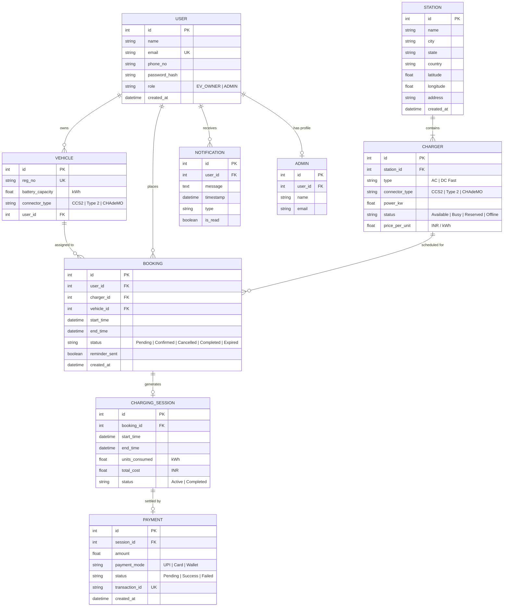
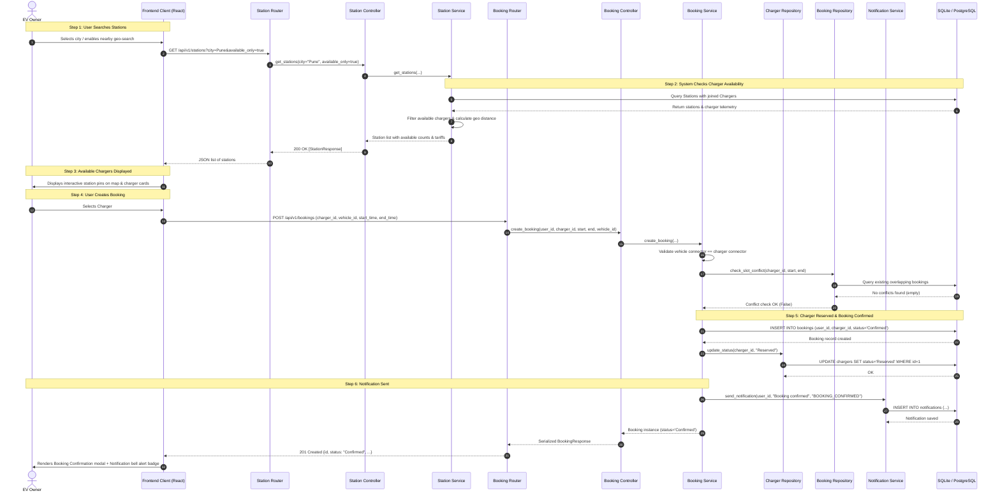

# EV Charging Station Management System (EVCSMS)

An enterprise-grade, full-stack EV Charging Station Management System engineered following strict **Object-Oriented Software Modeling and Design (OOSMD)** principles, **3NF database normalization**, **GRASP patterns**, and **SOLID principles**.

---

## 1. Tech Stack

- **Backend**:
  - Python 3.11+ / 3.14
  - FastAPI (REST API framework with automated Swagger UI at `/docs`)
  - SQLAlchemy 2.x (ORM with 3NF relational data model)
  - Pydantic v2 (Strict request/response validation)
  - SQLite (Default zero-config; switchable to PostgreSQL via `DATABASE_URL` environment variable)
  - JWT Authentication (Python-Jose + Bcrypt secure password hashing)
  - APScheduler (Periodic background cron engine)
  - Pytest (Automated test suite)
- **Frontend**:
  - React 18 + Vite
  - Tailwind CSS (EV Aesthetic: Sleek dark navy `#060a14` + electric green/cyan accents `#10b981` / `#0ea5e9`)
  - React Router DOM v6 (Role-protected routing)
  - Axios (JWT bearer interceptors & error handlers)
  - Leaflet & React-Leaflet (Interactive charging station map)
  - Recharts (Interactive Admin usage, revenue, and utilization analytics)
  - Lucide React (Modern iconography)

---

## 2. Actors & Responsibilities

1. **EV Owner**:
   - Register, authenticate, manage electric vehicles (battery capacity & connector standards).
   - Discover charging stations on an interactive map with city, connector, and availability filters.
   - Reserve charging slots with automatic connector compatibility checking and overlap rejection.
   - Initiate and monitor live charging sessions with real-time kWh and cost tickers.
   - Process payments via mock Strategy-based gateway (UPI, Card, Wallet) and download GST tax invoices.
   - Receive real-time reservation confirmations, advance reminders, and alerts.
2. **Station Admin**:
   - Create, edit, and manage charging stations and hardware chargers.
   - Configure live power ratings (kW), connector types (CCS2, Type 2, CHAdeMO), and unit pricing (₹/kWh).
   - Override charger operational states (`Available`, `Busy`, `Reserved`, `Offline`).
   - Analyze usage reports, revenue charts, and charger utilization metrics.
3. **Payment Gateway (Mock)**:
   - Evaluates transactions via Strategy pattern (`UPIPayment`, `CardPayment`, `WalletPayment`) and returns unique transaction IDs.
4. **System Scheduler (APScheduler)**:
   - Expire unclaimed bookings 10 minutes past start time and auto-release chargers.
   - Dispatch "Booking starts in 15 minutes" advance reminder alerts.
   - Auto-release idle reserved chargers.

---

## 3. OOSMD Design & Architecture Patterns

### Architectural Layers
```
FastAPI Routers ──> Controllers (GRASP) ──> Services (SOLID) ──> Repositories ──> SQLAlchemy Models
```

### GRASP Patterns Applied
1. **Controller Pattern (`BookingController`, `SessionController`, `PaymentController`)**:
   Coordinates system events between presentation routers and service layers.
2. **Creator Pattern (`Booking` creates `ChargingSession`)**:
   `Booking` holds the reservation window and charger association, possessing the exact context required to instantiate `ChargingSession`.
3. **Information Expert (`ChargingSession`)**:
   Maintains energy meter telemetry and duration; responsible for calculating consumed units ($\text{kWh} = \text{kW} \times \text{hours}$) and total billable cost ($\text{Cost} = \text{Units} \times \text{Tariff}$).
4. **High Cohesion (`NotificationService`)**:
   Focused strictly on alert creation, dispatching, and mark-as-read operations.
5. **Low Coupling (`Payment`)**:
   Coupled only to `ChargingSession` and `User`; operates independently of station routing or hardware layers.

### SOLID Principles Applied
- **SRP (Single Responsibility Principle)**: `PaymentService` manages billing and transactions only.
- **OCP (Open-Closed Principle) & LSP (Liskov Substitution Principle)**:
  `PaymentMethod` abstract strategy base class implemented by `UPIPayment`, `CardPayment`, and `WalletPayment`. New strategies (e.g. `CryptoPayment`) can be registered at runtime without modifying existing code.
- **ISP (Interface Segregation Principle)**:
  Segregated interfaces `IBookingService`, `IPaymentService`, `IStationService`, and `ISessionService`.
- **DIP (Dependency Inversion Principle)**:
  Controllers and services depend on abstractions injected via FastAPI `Depends()`.

---

## 4. Setup Guide for Windows (PowerShell)

### Prerequisites
- Python 3.11+ installed (`python --version`)
- Node.js v18+ and npm installed (`node --version`, `npm --version`)

---

### Step A: Backend Setup & Run

Open **PowerShell** and navigate to the backend directory:

```powershell
# Navigate to backend
cd evcsms\backend

# (Optional) Create and activate virtual environment
python -m venv .venv
.\.venv\Scripts\Activate.ps1

# Install required dependencies
pip install -r requirements.txt

# Seed the database with Pune & Mumbai stations, 6 chargers, Admin & EV Owner accounts
python seed.py

# Run the backend FastAPI server
uvicorn app.main:app --reload --host 0.0.0.0 --port 8000
```

- **Backend API Base**: `http://localhost:8000`
- **Interactive Swagger Docs**: `http://localhost:8000/docs`
- **Alternative ReDoc**: `http://localhost:8000/redoc`

---

### Step B: Frontend Setup & Run

Open a **second PowerShell window**:

```powershell
# Navigate to frontend
cd evcsms\frontend

# Install dependencies (React, Vite, Tailwind CSS, Leaflet, Recharts, Lucide)
npm install

# Start Vite development server
npm run dev
```

- **Frontend Application URL**: `http://localhost:5173`

---

### Step C: Default Seed Accounts

You can click the 1-click demo buttons on the login page or enter credentials manually:

| Actor | Email | Password | Role | Registered Vehicle |
|---|---|---|---|---|
| **Station Admin** | `admin@evcsms.com` | `adminpassword123` | `ADMIN` | — |
| **EV Owner** | `owner@evcsms.com` | `ownerpassword123` | `EV_OWNER` | `MH-12-EV-2024` (CCS2, 40.5 kWh) |

---

## 5. Running Automated Backend Tests

In the backend directory, run `pytest`:

```powershell
cd evcsms\backend
python -m pytest -v
```

### Verified Test Cases:
1. `tests/test_booking_conflict.py`:
   - Overlapping slot rejection (409 Conflict) for the same charger.
   - Non-overlapping booking success.
   - Vehicle connector compatibility validation (CCS2 vs Type 2).
2. `tests/test_session_cost.py`:
   - GRASP Information Expert unit test for energy kWh and cost calculation.
   - Live session start/stop lifecycle API verification.
3. `tests/test_payment_strategy.py`:
   - Liskov Substitution test across UPI, Card, and Wallet.
   - Open-Closed Principle test registering a runtime `CryptoPayment` strategy.
   - Card decline error handling.
4. `tests/test_api_endpoints.py`:
   - User registration, login, and `/auth/me` JWT retrieval.
   - Station search with city and Haversine geo-distance filters.
   - Admin RBAC access protection.

---

## 6. Entity-Relationship Diagram (3NF)



---

## 7. Class Diagram (OOP, GRASP, SOLID)

```mermaid
classDiagram
    direction TB

    class BookingController {
        -IBookingService booking_service
        +create_booking(user_id, charger_id, start_time, end_time, vehicle_id)
        +get_user_bookings(user_id)
        +cancel_booking(booking_id, user_id)
    }

    class SessionController {
        -ISessionService session_service
        +start_session(booking_id, user_id)
        +stop_session(session_id, user_id, custom_units)
        +get_session(session_id)
    }

    class PaymentController {
        -IPaymentService payment_service
        +process_payment(session_id, user_id, payment_mode, details)
        +get_user_payments(user_id)
        +get_invoice(payment_id, user_id, is_admin)
    }

    class IBookingService {
        <<interface>>
        +create_booking(...)
        +check_slot_conflict(...)
    }

    class IPaymentService {
        <<interface>>
        +process_payment(...)
        +get_invoice(...)
    }

    class PaymentMethod {
        <<abstract>>
        +mode_name: str
        +process_transaction(amount, details)* Tuple
    }

    class UPIPayment {
        +mode_name: "UPI"
        +process_transaction(amount, details) Tuple
    }

    class CardPayment {
        +mode_name: "Card"
        +process_transaction(amount, details) Tuple
    }

    class WalletPayment {
        +mode_name: "Wallet"
        +process_transaction(amount, details) Tuple
    }

    class ChargingStation {
        +int station_id
        +string name
        +string city
        +float latitude
        +float longitude
    }

    class Charger {
        +int charger_id
        +string type
        +string connector_type
        +float power_kw
        +string status
        +float price_per_unit
        +reserve()
        +start_charging()
        +release()
    }

    class Vehicle {
        +int vehicle_id
        +string reg_no
        +float battery_capacity
        +string connector_type
        +is_compatible_with(charger_connector) bool
    }

    class Booking {
        +int booking_id
        +datetime start_time
        +datetime end_time
        +string status
        +create_session() ChargingSession
        +cancel()
        +expire()
    }

    class ChargingSession {
        +int session_id
        +datetime start_time
        +datetime end_time
        +float units_consumed
        +float total_cost
        +compute_energy_and_cost(power_kw, price_per_unit, end_time) float
    }

    class Payment {
        +int payment_id
        +float amount
        +string payment_mode
        +string transaction_id
    }

    class Notification {
        +int notification_id
        +int user_id
        +string message
        +mark_as_read()
    }

    IBookingService <|.. BookingService
    IPaymentService <|.. PaymentService
    PaymentMethod <|-- UPIPayment
    PaymentMethod <|-- CardPayment
    PaymentMethod <|-- WalletPayment

    BookingController --> IBookingService
    PaymentController --> IPaymentService
    Booking ..> ChargingSession : creates (Creator)
    ChargingSession ..> Charger : references power (Expert)
    Booking --> Vehicle : validates connector
```



---

## 8. Sequence Diagram: Book Charging Slot



---

## 9. Use Case Summary

| ID | Name | Actor | Description |
|---|---|---|---|
| **UC-01** | Register & Login | EV Owner | JWT authentication, bcrypt security |
| **UC-02** | Manage Vehicles | EV Owner | Register EV with battery capacity & connector type |
| **UC-03** | Search Stations | EV Owner | Map & list search with filters and Haversine distance |
| **UC-04** | Check Charger Availability | EV Owner | Real-time port status & tariff inspection |
| **UC-05** | Book Charging Slot | EV Owner | Reserve slot, conflict checking, connector validation |
| **UC-06** | Start Charging Session | EV Owner | Initiates hardware charging within confirmed time window |
| **UC-07** | Stop Charging Session | EV Owner | Computes kWh delivered & total cost |
| **UC-08** | Process Payment | EV Owner | Strategy-based mock settlement (UPI/Card/Wallet) |
| **UC-09** | Download Tax Invoice | EV Owner | View itemized invoice with 18% GST breakdown |
| **UC-10** | Receive Notifications | EV Owner | Advance 15-min reminders, booking/payment alerts |
| **UC-11** | Station Management | Station Admin | Add/Edit stations with GPS coordinates |
| **UC-12** | Charger Configuration | Station Admin | Set power ratings (kW), connectors, and tariffs (₹/kWh) |
| **UC-13** | Operational Overrides | Station Admin | Toggle charger status (Available, Busy, Reserved, Offline) |
| **UC-14** | Analytics & Reports | Station Admin | Recharts graphs for daily usage, revenue, and utilization |
| **UC-15** | Auto-Expiration & Reminders | System Scheduler | Expire unclaimed bookings (10 min) & send reminders |

---

## 10. Separate Markdown Diagram Files (`docs/`)

The `docs/` folder contains standalone Mermaid diagrams ready to be copied into draw.io, reports, or slides:
- `docs/er_diagram.md`: 3NF Entity Relationship Diagram
- `docs/class_diagram.md`: OOP Architecture & Class Diagram
- `docs/sequence_diagram.md`: Booking Slot Sequence Diagram
- `docs/use_cases.md`: Complete Use Cases Specification
