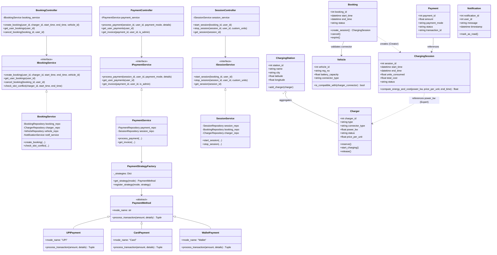

# Class Diagram - EVCSMS (OOP & Architecture)

Demonstrating Object-Oriented Software Modeling and Design (OOSMD) patterns:
- **GRASP Patterns**:
  - `BookingController`: GRASP Controller coordinating booking workflows.
  - `Booking`: GRASP Creator for `ChargingSession`.
  - `ChargingSession`: GRASP Information Expert calculating energy and total cost.
  - `Notification`: GRASP High Cohesion handling messaging only.
  - `Payment`: GRASP Low Coupling dependent only on Session and User.
- **SOLID Principles**:
  - **Single Responsibility Principle (SRP)**: `PaymentService` manages billing only.
  - **Open-Closed Principle (OCP)** & **Liskov Substitution Principle (LSP)**: `PaymentMethod` strategy hierarchy (`UPIPayment`, `CardPayment`, `WalletPayment`) swappable without client code modifications.
  - **Interface Segregation Principle (ISP)**: `IBookingService`, `IPaymentService`, `IStationService`, `ISessionService`.
  - **Dependency Inversion Principle (DIP)**: High-level controllers depend on service interfaces injected via FastAPI.

