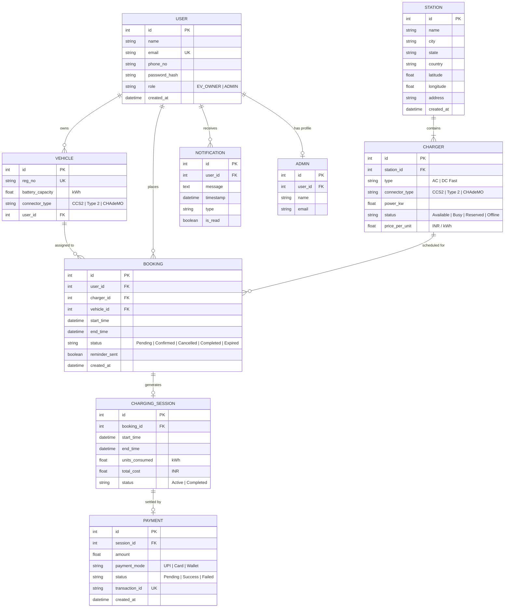

# Entity-Relationship Diagram (3NF) - EVCSMS

The database design strictly satisfies Third Normal Form (3NF):
- Every non-key attribute depends directly on the primary key, the whole key, and nothing but the key.
- Transitive dependencies are removed (e.g. Station attributes isolated from Chargers, Session attributes isolated from Bookings).

