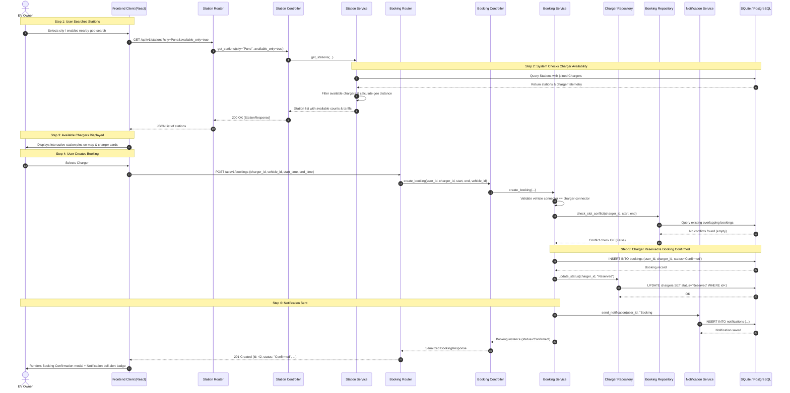

# Sequence Diagram: Book Charging Slot - EVCSMS

This sequence diagram directly models the booking workflow:
`User searches stations -> system checks charger availability -> available chargers displayed -> user creates booking -> charger reserved -> booking confirmed -> notification sent.`

